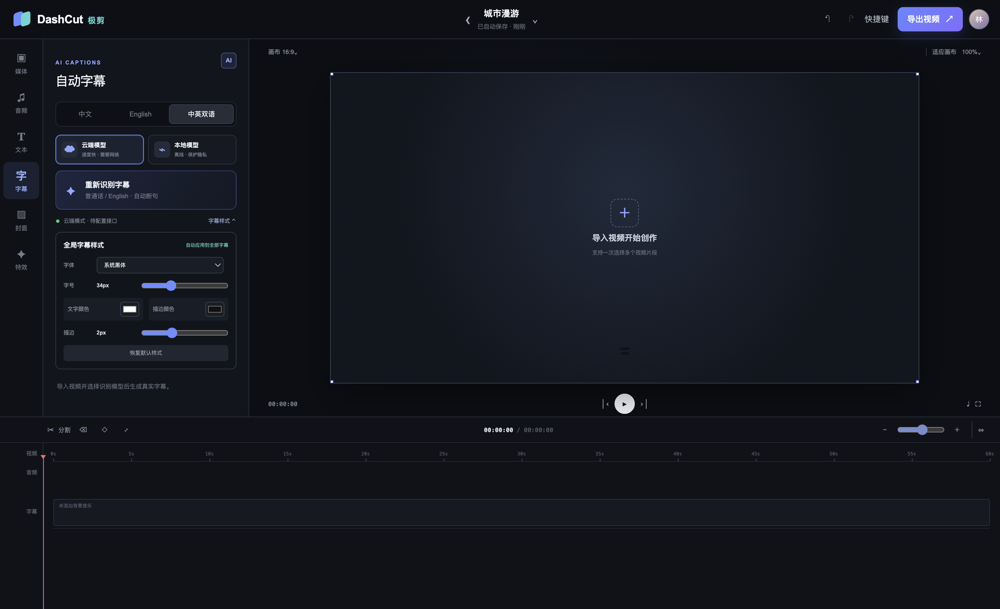
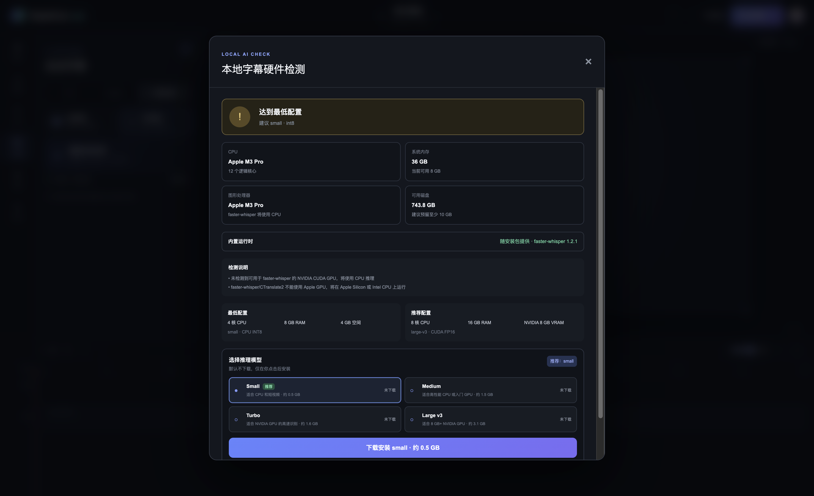

# DashCut 极剪

[简体中文](README.zh-CN.md) · [Download](https://github.com/Mikasathebest/DashCut/releases/latest) · [Report an issue](https://github.com/Mikasathebest/DashCut/issues)

## 1. Overview

DashCut (极剪) is a desktop-first video editor for Bilibili and YouTube creators. It focuses on the repetitive work around creator videos: import multiple clips, split and rearrange a timeline, add background music, design a cover image, create time-aligned Chinese or English captions with local `faster-whisper`, apply one font/color/size style to every caption, and prepare 30 or 60 FPS exports. The local AI workflow checks CPU, GPU, memory, and disk before recommending a model; model weights are never downloaded until the user explicitly clicks install, and packaged users do not need to configure Python or other AI dependencies.

Highlights:

- Multi-clip import, preview, timeline splitting, and removal
- Local Chinese and English speech recognition with editable caption timing and text
- Global caption font, size, color, outline, and background controls
- On-demand `small`, `medium`, `turbo`, and `large-v3` model management
- Automatic hardware assessment with CPU INT8 and CUDA recommendations
- Background music controls, 16:9 / 9:16 canvases, and a cover-image studio
- Bilibili and YouTube export presets with 30 / 60 FPS choices
- Unsigned Windows x64 one-click `.exe` releases and one macOS Apple Silicon `.dmg`; Apple credentials automatically enable signing and notarization

> Bilingual subtitles: local Whisper now combines with AI API translation to produce Chinese and English captions while preserving recognition timestamps. Gemini cloud audio recognition is also available with estimated timing. See the [tested models, speed, cost and setup guide](docs/AI_API.md).

## 2. Installation

### Download an installer

[**Download the latest DashCut release →**](https://github.com/Mikasathebest/DashCut/releases/latest)

- Windows: download the x64 `.exe` and double-click it. Because it is unsigned, Windows may show an unknown-publisher or SmartScreen confirmation.
- macOS: the published `.dmg` supports Apple Silicon Macs (M1 or newer). Open it and move DashCut to Applications. Until the release is notarized, first launch may require right-clicking DashCut and choosing **Open**, or allowing it in **System Settings → Privacy & Security**.
- Local caption models are not bundled. Open **Captions → Local model**, review the hardware recommendation, then click **Download and install** for the model you want.

### Build and run manually

Requirements: Node.js 22.13+ and Python 3.9+ (Python is only needed to build the self-contained local AI runtime).

```bash
git clone https://github.com/Mikasathebest/DashCut.git
cd DashCut
npm install
npm run runtime:build
npm run desktop
```

Create local installers with:

```bash
npm run dist:win   # Windows x64 .exe
npm run dist:mac   # macOS .dmg
```

Windows x64 releases produce an unsigned one-click `.exe` without credentials; Windows may display an unknown-publisher or SmartScreen warning. The macOS Apple Silicon DMG is also produced without credentials, but Apple Developer credentials are required to sign and notarize it for a normal Gatekeeper launch. See [`docs/CODE_SIGNING.md`](docs/CODE_SIGNING.md). Both installers embed a self-contained LGPL FFmpeg runtime built natively with VideoToolbox on macOS or MediaFoundation on Windows, including its source notice, licenses, dependency licenses, and build configuration; details are documented in [`docs/FFMPEG_RUNTIME.md`](docs/FFMPEG_RUNTIME.md).

## 3. Tutorial



### Import and edit on a multi-track timeline

1. Click **Import media** (⌘I) and pick any mix of videos, images, GIFs and audio. They appear in the library in import order with a first-frame thumbnail and duration; nothing is placed on the timeline automatically.
2. Drag media from the library onto a track. On the main track a caret shows where the clip will land: drop on the strip before 0:00, or on the first half of a clip, to insert in front of it. Images last 4 seconds by default. Drop on the empty strip above the tracks to create a new overlay track, so images and videos can be stacked.
   In the library, ⌘A selects all, ⌘C/⌘X/⌘V copy, cut and paste entries (⌘V on the timeline places them at the playhead), and ⌘/⇧-click selects several.
3. Use the toolbar above the timeline: import, select/blade mode, undo/redo/reset, split, trim left/right, delete, marker, freeze, reverse, mirror, rotate, crop, smart talk cut, smart scene split and a voice-over recorder with a 3-second countdown. Toggles on the right control main-track magnet, snapping, linkage and the hover preview axis; −/+ zooms the timeline and **…** sets track height and waveform size.
4. Select a clip to edit it in the right-hand panel: picture (scale, position, rotation, opacity, mirror, crop), audio (volume, fades, sound tools), speed, in/out animations, colour adjustment and AI effects. Preview and export use the same settings.
5. Click the cover tile at the left of the main track to open the cover studio: upload one or more pictures (several at once are laid out as a collage, with side-by-side, stacked, grid and one-large layouts), drag the frame slider to pick any video frame as the background or as an extra layer, and add your own text boxes with font, size, color, stroke, shadow and box. Drag layers to move them and use the handles to resize. The cover is 1920 × 1080 (or 1080 × 1920 for 9:16) and is saved with the project.

### Original audio and sound tools

- A video's own sound gets its own **Original audio** lane under the video track, with its waveform. Drag the yellow line up or down to set the volume (0–200%); the speaker button mutes it.
- The **Audio** tab in the right panel has loudness normalisation (−14/−16/−23 LUFS), noise reduction, voice beautify and voice enhance, stereo balance, channel layout (stereo, mono, left, right, swap) and pitch shift in semitones without changing the duration.
- **Voice separation** keeps only the voice or only the background. It runs the MIT-licensed HTDemucs model on your computer; the first use downloads the model (about 80 MB) and separation of long videos takes a few minutes. Results are cached.
- **Video translation** (Audio tab → *Translate and dub*) uses the captions: lines missing the target language are translated with your AI API settings, then each line is voiced with a built-in system voice and fitted to the caption's timing (sped up to 1.6× if needed). The dub goes on a new audio track, and the original can keep only its background, be ducked to 15% or be muted.

### Keyframes, titles, transitions and speed curves

- **Keyframes:** in **Picture** (position, scale, rotation, opacity) and **Audio** (volume), click ◆ to add a keyframe at the playhead; changing a value with keyframes present edits the one at the playhead. ‹ › jump between keyframes, the easing menu picks linear, ease-in, ease-out, ease-in-out or hold, and diamonds mark keyframes on the timeline.
- **Titles:** the **Text** tab adds styled titles (headline, subtitle, outline, banner, tag, serif) at the playhead on an overlay track. Edit text, font, size, colours, outline, background and shadow in the right panel. Preview and export render titles with the same code.
- **Transitions:** select a main-track clip, open **Animation** and choose crossfade, dip to black, wipe or slide to the next clip. Transitions use spare footage on both sides of the cut and fall back to a dip when there isn't enough.
- **Speed curves:** in **Speed**, pick ramp up, ramp down, montage, hero, bullet time or flash, then drag the points. Audio keeps its pitch.
- **Scrubbing:** click anywhere on the ruler or an empty part of the tracks to jump there, and drag (or drag the red playhead) to preview any moment. Hold ⇧ or ⌘ while dragging on empty space to marquee-select clips.
- **Tracks:** the add-track button in the timeline toolbar adds an empty overlay video track or audio track; added tracks stay until you remove them with the × in the track header.
- **Caption selection:** click a caption lane, then ⌘A / Ctrl+A selects every caption and ⌫ deletes them all (undoable). ⇧/⌘-click captions to pick several.
- **Keyboard:** J/K/L shuttle (press again for 2× and 4×), ←/→ step one frame (⇧ for 10), ⌘C/⌘X/⌘V copy, cut and paste clips at the playhead, ⌘D duplicates. ⇧- or ⌘-drag on empty timeline space to marquee-select.

### Edit by transcript and clean up talking-head takes

1. Open the **Transcript** tab and click **Recognise transcript**. Add names, brands or jargon under **Vocabulary** in the captions tab so the local model spells them correctly.
2. Select words by clicking, dragging or shift-clicking, then press ⌫. The matching video, audio and captions are cut and the timeline closes the gap. It is one undo step.
3. **Smart clean cut**, in the transcript tab or the toolbar, lists filler words (嗯/啊/um/uh), stutters, long pauses and abandoned retakes. Fillers that are often real words (那个/就是/like/so) are listed but left unchecked. Review the list, adjust the pause threshold or filler lists, then apply the checked items. Clips without a transcript fall back to silence detection.

### Edit with 极剪助手 (the AI assistant)

1. Click **✦ 极剪助手** in the top bar (⌘J). In settings (**…**), choose **Claude (Anthropic API)** or any **OpenAI-compatible** endpoint with tool calling, then enter the model and API key. Keys are encrypted with the macOS keychain via Electron `safeStorage` and never written to disk in plain text. A model server on `http://127.0.0.1` (Ollama, LM Studio) also works.
2. Describe the edit, or pick a built-in task: **口播精剪** (clean talking-head cut), **双语字幕** (bilingual captions), **60 秒精华** (60-second highlight) or **转竖屏 9:16** (reformat to vertical).
3. The assistant reads a compact view of the timeline and shows a plan. Nothing changes until you click **确认执行**; **修改方案** sends your feedback instead. Edits are validated as a batch and applied as one step, so ⌘Z or **撤销这次修改** reverts all of them, including canvas and caption-style changes. **停止** cancels a running task.

### Save, reopen and recover projects

- **File → Save** (⌘S) writes a `.dashcut` project file. Media is referenced, not copied: paths are stored relative to the project file, so moving the project folder together with its media keeps working.
- **File → Open** (⌘O) or the project menu next to the title reopens projects; the menu also lists recent projects. If media was moved, DashCut asks you to locate it, and other missing files with the same names in that folder are relinked automatically.
- Unsaved work is autosaved every 30 seconds and whenever the window loses focus. After a crash, DashCut offers to restore it on the next launch. Closing a project with unsaved changes asks whether to save first.

### Extract Chinese or English captions locally

1. Open **Captions**, choose **Local model**, and let DashCut inspect the device.
2. Review the detected CPU, CUDA GPU, memory, disk, and runtime status. Pick the recommended model or another supported model.
3. Click **Download and install**. Nothing is downloaded before this explicit action.
4. Import the clips, select the subtitle view (**中文**, **English**, or **双语**), then click **Generate captions**.
5. `faster-whisper` detects each clip's spoken language. Chinese recognition is written to the Chinese field; English recognition is written to the English field. Review each line and correct names or punctuation before export.
6. For automatic bilingual captions, enter your AI API API key and enable automatic translation. Qwen3 Next is the default translator; Gemini 3.5 Flash is a tested alternative. Disable automatic translation for offline source-language recognition. Both caption lines remain editable.



### Apply one subtitle style everywhere

Captions are edited directly on the timeline's caption track: double-click text to change it, drag the ends to retime, double-click empty space to add one, and press ⌫ to delete the selection.

1. In **Captions**, click **Subtitle style**.
2. Choose the font, text size, text color, outline color/width, and background opacity.
3. Changes are applied immediately to every caption and reflected in the preview. Use **Restore defaults** to reset the full style.
4. Choose the Bilibili or YouTube preset, select 30 or 60 FPS, and export after reviewing the timeline.

### Publish: presets, loudness, smart reframe and pre-publish check

- **Export presets:** Bilibili 16:9 1080p60, YouTube 4K (HEVC), Shorts/Douyin 9:16, audio only (M4A) and GIF. You can also pick the format (MP4, MOV, M4A, WAV, GIF), codec (H.264 or the smaller HEVC), resolution and frame rate yourself.
- **Loudness:** export can normalise the mix to −14 LUFS (YouTube/Bilibili), −16 (podcast/mobile) or −23 (EBU R128). It measures first, then applies loudnorm. A live LUFS meter beside the player shows preview loudness against the target.
- **Smart reframe (✦ 智能转竖屏):** detects faces locally (MediaPipe BlazeFace, downloaded once, about 0.2 MB) and turns 16:9 footage into a 9:16 cover-fit framing with smooth horizontal keyframes that follow the speaker. A tracking-speed setting trades calm pans for tighter following, and the keyframes stay editable.
- **Pre-publish check:** renders the timeline once without writing a file. It reports loudness and true peak, black frames, long silences, captions that are too long, too fast, too brief or overlapping, and missing media, each with a jump or a one-click fix.

### Interface language

The **中 / EN** switch in the top bar changes the interface, menus and dialogs between Chinese and English. DashCut starts in Chinese and remembers your choice. Translations live in `app/i18n/en/*.ts`, keyed by the Chinese source text; untranslated strings fall back to Chinese.

## 4. Contributing and merging code

1. Fork the repository and create a focused branch such as `feat/subtitle-translation` or `fix/timeline-split`.
2. Install dependencies with `npm install`, implement the change, and add or update tests.
3. Run `npm run lint`, `npm test`, and `npm run desktop:smoke` before pushing.
4. Use a clear conventional commit, for example `feat: add bilingual translation provider`.
5. Push the branch and open a pull request against `main`. Explain the user impact, verification steps, platforms tested, and include screenshots for UI changes.
6. A maintainer reviews the pull request. Merge only after required checks pass and review comments are resolved; prefer **Squash and merge** so `main` keeps one coherent commit per pull request.

Please keep credentials, model weights, build output, and signing certificates out of commits. For larger changes, open an issue first so the implementation and compatibility plan can be agreed on.

## 5. License

DashCut is released under the [MIT License](LICENSE). FFmpeg is distributed under LGPLv2.1-or-later; other components and downloaded AI models remain subject to their own licenses and terms. See [Third-party notices](THIRD_PARTY_NOTICES.md).
